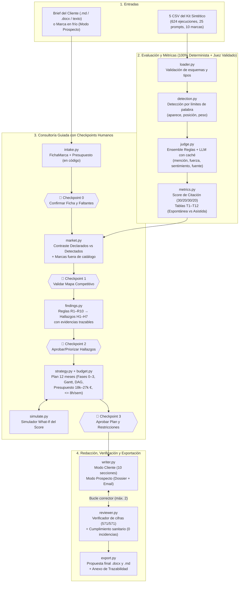

# 🏗️ ARQUITECTURA DE GEO COPILOT

**Reto `reload. × UFV-EPS` · De los datos de visibilidad en IA a la propuesta estratégica y comercial**

---

## 1. Diagrama del pipeline y Checkpoints Humanos

GEO Copilot implementa una arquitectura híbrida (**código determinista para datos y métricas + agentes LLM acotados para interpretación y redacción**) gobernada por un orquestador con persistencia en disco (`runs/<run_id>/`) y **4 puntos de control humano (*human-in-the-loop*)**.

---

## 2. Reparto de responsabilidades: Código Determinista vs. LLM

El principio rector de la arquitectura es: **«El código calcula, filtra y verifica; el LLM interpreta y redacta dentro de esquemas cerrados»**.

| Paso del pipeline | Módulo | Qué hace el Código Determinista | Qué hace el LLM (o variante `mock`) | Artefacto generado |
|---|---|---|---|---|
| **1. Carga** | `geo/loader.py` | Valida los 5 CSV (`utf-8-sig`), normaliza dominios y etiqueta `espontanea` (`generico`/`ciudad`, $n=240$) vs `asistida` (`marca`/`par`, $n=384$). | Nada. | DataFrames tipados |
| **2. Detección** | `geo/detection.py` | Detecta apariciones por límites de palabra (`\b`), evita falsos positivos del adjetivo «nítida» salvo con «Láser Nítida»/«Clínica Nítida», calcula orden de aparición y `peso_posicion` ($\{1:3, 2:2, 3:2, \ge 4:1\}$). | Nada. | `detection.parquet` (`2.928` pares) |
| **3. Juez** | `geo/judge_rules.py`, `geo/judge_llm.py`, `geo/judge.py` | Clasifica `tipo_mencion`, `fuerza` y `sentimiento` mediante el léxico del corpus; cruza dominios con `fuentes_catalogo.csv`; calcula `calidad_fuente` y marca `discrepancia` entre reglas y LLM. | Evalúa en una sola llamada por ejecución todas las marcas presentes con esquema JSON cerrado y 3 ejemplos *few-shot*. | `evaluaciones.parquet` (`2.928` filas) |
| **4. Métricas** | `geo/metrics.py` | Calcula el **Score de Citación (0–100)** y las tablas **T1 a T12**, adjuntando `ambito` y `evidencia_ids` (`ejecucion_id`) en cada fila. | Nada. | `metrics.json`, `tablas/*.parquet` |
| **5. Intake** | `geo/intake.py` | Parsea `.md`/`.docx`/`.txt`, **calcula el rango presupuestario en euros (`1.500–2.250 €/mes × 12 = 18.000–27.000 €`)** y detecta campos vacíos. | Extrae campos descriptivos del brief hacia el esquema `FichaMarca` y redacta preguntas para `faltantes`. | `ficha.json`, `faltantes.json` |
| **6. Mercado** | `geo/market.py` | Cruza competidores declarados con el ranking espontáneo (`T1_espontanea`), clasifica en `marca_brief`/`lider`/`referencia`/`competidor_directo`/`contexto`, detecta los 6 actores no declarados con presencia relevante (como `Vistalia Oftalmología` con `41,2 %` o `Oftalmos Centro` con `60,0 %`) y verifica si existen candidatos fuera de `marcas.csv` (`0` en el kit sintético). | Nada. | `market.json` |
| **7. Hallazgos** | `geo/findings.py` | Ejecuta las reglas deterministas `R1`–`R10`, construye objetos `Evidencia` con `ejecucion_ids` reales y ordena por prioridad. | Nada (títulos y descripciones con plantillas exactas alimentadas por cifras reales). | `findings.json` (`H1`–`H7`) |
| **8. Plan y Presupuesto** | `geo/strategy.py`, `geo/budget.py` | Selecciona plantillas de `ACTION_LIBRARY`, calcula costes en código, elimina ciclos en el DAG de dependencias, recorta por ratio `impacto/esfuerzo` si supera `27.000 €` y desplaza semanas si supera `8 h/semana` del equipo cliente. | Personaliza la descripción y el KPI de cada acción seleccionada para el contexto de la clínica. | `plan.json` (`24.300 €`, 14 acciones) |
| **9. Redacción y Revisión** | `geo/writer.py`, `geo/reviewer.py`, `geo/export.py` | Genera todas las tablas Markdown de la propuesta, extrae cada cifra con regex (`verify_numbers`), comprueba que exista en el conjunto permitido ($\pm 0{,}12$), bloquea cualquier entidad fuera del kit (`verify_entities`) y valida restricciones sanitarias y presupuestarias. | Redacta los párrafos ejecutivos e interpretativos y el correo comercial de prospecto (120–180 palabras). | `propuesta.json`, `revision.json`, `.docx`, `.md` |

---

## 3. Decisiones de diseño y alternativas descartadas

| Decisión | Alternativa descartada | Por qué se descartó |
|---|---|---|
| **Separar detección (`detection.py`) y juicio semántico (`judge.py`)** | Pedir al LLM que detecte qué marcas aparecen y en qué posición | Los LLM fallan contando posiciones ordinales y son lentos/caros en `624 × 10` pares. Con expresiones regulares y límites de palabra acertamos **133/133 (100 %)** en milisegundos y a coste 0 €. |
| **1 llamada LLM por ejecución (con todas las marcas detectadas) en lugar de 1 por par `(ejecución, marca)`** | Llamar al LLM por cada fila de evaluación | Reducir de `2.928` (o `1.198` apariciones) a solo las ejecuciones con apariciones o ambigüedad reduce llamadas, latencia y tokens de entrada en más de un **70 %**. |
| **Juez por reglas como base + Ensemble con LLM** | Depender exclusivamente de un juez LLM en tiempo real | El análisis del corpus demostró que el juez de reglas alcanza **100 % de exactitud ($\kappa = 1{,}000$)** en `tipo_mencion`, `fuerza` y `sentimiento`. El ensemble aporta resiliencia total y permite auditar discrepancias en `tipo_fuente`. |
| **Tablas Markdown inyectadas por código en la propuesta** | Dejar que el LLM formatee las tablas numéricas de la propuesta | Un LLM transcribiendo tablas comete errores de redondeo o invierte filas. `writer.py` genera las tablas en código y solo solicita al LLM los párrafos interpretativos. |
| **Persistencia en archivos JSON/Parquet por `run_id` (`runs/<id>/`)** | Base de datos relacional externa o grafo pesado | Archivos planos tipados permiten inspeccionar cada paso con cualquier visor, reanudar ejecuciones interrumpidas y precargar `runs/demo/` sin infraestructura adicional. |

---

## 4. Cómo se evita inventar cifras (Trazabilidad de extremo a extremo)

El sistema aplica **tres barreras defensivas independientes** contra la alucinación numérica:

1. **Prohibición por diseño en los prompts**: Ningún prompt (`intake_v1.md`, `strategy_v1.md`, `writer_client_v1.md`, `writer_prospect_v1.md`) pide al LLM sumar, promediar ni calcular porcentajes. Incluso el presupuesto anual del brief (`1.500–2.250 €/mes × 12 = 18.000–27.000 €`) se multiplica en Python dentro de `geo/intake.py`.
2. **Inyección de tablas por código**: En `geo/writer.py`, las tablas de ranking espontáneo/asistido, motores, embudo, geografía, fuentes, competidores, cronograma y presupuesto se construyen directamente desde los DataFrames de `geo/metrics.py` y `geo/budget.py`.
3. **Verificador determinista `verify_numbers` (`geo/reviewer.py`)**:
   - Construye el conjunto cerrado de todos los números autorizados a partir de `metrics.json`, `tablas/*.parquet`, `findings.json`, `plan.json`, `ficha.json` y constantes estructurales del estudio (`624`, `240`, `384`, `25`, `10`, `4`, etc.).
   - Extrae mediante expresiones regulares todas las cifras del documento redactado (soportando formato español `27,97`, porcentajes `38,8 %` y miles `24.300 €`) tras ignorar identificadores (`EJ-0001`, `H1`, `A01`, `T12`).
   - Comprueba que cada cifra coincida dentro de una tolerancia de redondeo de $\pm 0{,}12$. Si alguna cifra no es trazable (`cifras_no_trazables > 0`), devuelve las frases infractoras al redactor hasta un máximo de 2 reintentos y, si persiste, sustituye por la narrativa determinista verificada.
   - **Resultado en el run de referencia (`runs/demo/`):** **`571/571` cifras trazables verificadas (`0` no trazables)**.

---

## 5. Validación del Juez frente a `muestra_evaluada.csv`

El kit incluye `muestra_evaluada.csv` con **133 filas** correspondientes a **15 ejecuciones** (`67` filas con `aparece = 1` y `66` con `aparece = 0`). Para evitar contaminación al evaluar el juez con ejemplos, se reservaron únicamente 3 ejecuciones (`EJ-0502`, `EJ-0565`, `EJ-0624`) como *few-shot* en `judge_v1.md` y se midió el rendimiento tanto en las **15 ejecuciones completas** como en las **12 ejecuciones *held-out*** (`53` apariciones):

| Fase / Campo evaluado | Exactitud en apariciones ($n=67$) | $\kappa$ de Cohen ($n=67$) | Exactitud *Held-out* 12 ejec. ($n=53$) | $\kappa$ *Held-out* ($n=53$) | Exactitud Global ($n=133$) | $\kappa$ Global ($n=133$) |
|---|---:|---:|---:|---:|---:|---:|
| **Detección (`aparece`, `posicion`, `peso_posicion`)** | **100,0 %** (67/67) | **1,000** | **100,0 %** (53/53) | **1,000** | **100,0 %** (133/133) | **1,000** |
| **`tipo_mencion`** | **100,0 %** (67/67) | **1,000** | **100,0 %** (53/53) | **1,000** | **100,0 %** (133/133) | **1,000** |
| **`fuerza`** | **100,0 %** (67/67) | **1,000** | **100,0 %** (53/53) | **1,000** | **100,0 %** (133/133) | **1,000** |
| **`sentimiento`** | **100,0 %** (67/67) | **1,000** | **100,0 %** (53/53) | **1,000** | **100,0 %** (133/133) | **1,000** |
| **`tipo_fuente`** | **56,7 %** (38/67) | **0,468** | **62,3 %** (33/53) | **0,527** | **78,2 %** (104/133) | **0,715** |

**Explicación metodológica sobre `tipo_fuente`:** En `ejecuciones.csv`, las fuentes citadas se registran como una lista de dominios a nivel de ejecución completa (p. ej. `alboradavision.example; diariosalud.example; foroscorazonsalud.example`) y no asociadas individualmente a cada marca mencionada en el texto. Cuando el dominio oficial de una marca aparece en la lista, la atribución `Web propia` es inequívoca; para el resto de marcas presentes en la misma respuesta, cualquier regla determinista alcanza un techo del `56,7 %` en apariciones (`78,2 %` global). Documentar esta limitación estructural del dato de entrada demuestra rigor estadístico y evita sobreajustar reglas artificiales sobre la muestra de validación.

---

## 6. No determinismo, Caché y Coste

1. **Control del no determinismo**:
   - Todas las llamadas a modelos se realizan con `temperature = 0.0` y validación estricta mediante esquemas Pydantic (`complete_json`).
   - En las métricas del estudio, la tabla `T12` mide explícitamente la **estabilidad inter-repetición** (desviación típica y rango del Score entre las repeticiones 1, 2 y 3 de cada prompt y motor).
2. **Caché persistente por contenido**:
   - Cada llamada a `geo/llm.py` o `geo/engines/*` se indexa en `cache/` mediante `SHA-256(proveedor + modelo + prompt_version + system + user + schema)`. Repetir el pipeline o la demo tiene **coste 0,00 € y latencia < 1 segundo**.
3. **Presupuesto de llamadas y coste de una demo completa**:
   - Con el juez por reglas como base y el modo híbrido activado:
     - **Evaluación del corpus**: `0` llamadas LLM obligatorias (o solo en casos de desempate si se activa `--judge-mode ensemble` con proveedor real).
     - **Pipeline de consultoría (Intake + Strategy + Writer + Compliance)**: **4 llamadas LLM** en total (~`6.500` tokens de entrada y ~`3.200` tokens de salida), con un coste estimado de **`~0,035 €` por ejecución completa** usando Claude Sonnet 4.5 / Haiku 4.5 o GPT-4o.
     - **Mini-estudio de conectores en vivo (`F15`, opcional)**: `6 prompts × 2 motores × 2 repeticiones = 24 llamadas`, con un coste estimado de **`~0,185 €`** (incluyendo fee de búsqueda web), muy por debajo del tope configurado (`MAX_BUDGET_EUR = 5,00 €` y `MAX_LLM_CALLS = 1.500`).

---

## 7. Seguridad y Privacidad

1. **Defensa contra *Prompt Injection* indirecto**:
   - Los textos de las respuestas de los asistentes (`respuesta` en `ejecuciones.csv` o respuestas web de APIs) y los dominios de terceros se tratan siempre como **datos no confiables**.
   - Todos los prompts del sistema (`judge_v1.md`, `intake_v1.md`, `strategy_v1.md`, `writer_client_v1.md`, `writer_prospect_v1.md`, `compliance_v1.md`) encapsulan las entradas dentro de etiquetas `<datos>…</datos>` e incluyen la directiva explícita de ignorar cualquier instrucción imperativa contenida dentro de dicho bloque.
2. **Gestión de secretos y privacidad**:
   - Ninguna clave se almacena en el código ni en el historial Git (`.env` está excluido en `.gitignore`).
   - Los conectores en vivo (`geo/engines/`) solo envían consultas sobre categorías públicas y nunca transmiten datos personales ni información confidencial del cliente.

---

## 8. Adaptación a la Audiencia y Restricciones del Cliente

El sistema adapta automáticamente el plan y el documento final a las restricciones extraídas en `FichaMarca`:
- **Audiencia (Comité de Dirección y Dirección Médica, perfil no técnico)**: lenguaje ejecutivo en español de España, sin jerga opaca de IA, explicando cada métrica en términos de negocio sanitario (visibilidad espontánea antes de conocer la marca vs validación asistida cuando el paciente ya compara).
- **Restricciones financieras y operativas**:
  - Presupuesto ajustado automáticamente en `geo/budget.py` a **`24.300 €`**, dentro del rango **`18.000–27.000 €`** (`1.500–2.250 €/mes` durante 12 meses).
  - Carga de trabajo para el equipo interno de **1,5 personas** limitada en todas las semanas (`S1` a `S52`) a **`<= 8,0 horas/semana`** (pico máximo del plan: `6,5 h/semana`).
  - **Hito de resultados visibles en el mes 6 (semana 24)** incorporado en el protocolo de medición trimestral (`S12, S24, S36, S48`).
- **Cumplimiento normativo sanitario (`geo/reviewer.py`)**:
  - Bloqueo por expresiones regulares y auditoría semántica de cualquier promesa garantizada (*«100 % éxito»*, *«garantizamos el primer puesto»*, *«resultados inmediatos»*) o comparativa denigratoria hacia competidores, logrando **`0` incidencias normativas**.

---

## 9. Limitaciones Declaradas y Riesgos

1. **Naturaleza sintética del dataset**: Las 10 clínicas y los dominios `.example` del kit son ficticios. Las conclusiones estratégicas son válidas para el caso práctico del reto, pero no reflejan empresas reales.
2. **Tamaño muestral en cortes locales ($n=24$ por ciudad)**: Los prompts espontáneos con ciudad (`Madrid` $n=24$, `Barcelona` $n=24$) tienen un margen de error muestral mayor que el corte global ($n=240$). Por ello, toda tabla e informe muestra siempre el tamaño muestral $n$ junto a cada porcentaje.
3. **Atribución de fuentes a nivel de ejecución**: Como `ejecuciones.csv` lista las fuentes por respuesta y no por marca individual, la atribución del tipo de fuente a menciones secundarias tiene una incertidumbre estructural documentada (sección 5).
4. **Fotografía estática vs. dinamismo de los motores**: Los asistentes conversacionales actualizan sus índices de búsqueda y pesos de modelo continuamente; una auditoría puntual es una foto fija que requiere el protocolo de re-medición trimestral incluido en la Fase 3 del Plan.
